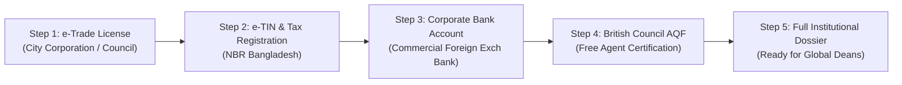

# OpenSTEM Compliance & Institutional Due Diligence Dossier
**Standard Institutional Disclosures, Due Diligence Q&A, and Legal Readiness Roadmap**  
**Organization:** OpenSTEM  
**Lead Correspondent:** Shahriyar Karim (`openstemrecruitment@gmail.com` / `shahriyarkarimsiam@gmail.com`)  
**Primary Domain:** `https://openstemrecruitment.com/`  
**Profile Date:** November 2026  

---

## 1. Official Institutional Information Profile (Submission Version)

This profile sets out OpenSTEM’s contact details, legal representation, and the scope of cooperation proposed for formal discussion with universities. It serves as our initial institutional disclosure for compliance and partner onboarding review.

### Institutional Identity & Point of Contact
| Parameter | Institutional Record |
|---|---|
| **Organization Name** | OpenSTEM |
| **Recruitment Platform** | [https://openstemrecruitment.com/](https://openstemrecruitment.com/) |
| **Ecosystem Network** | [Library](https://openstemlibrary.com/) \| [Replicate](https://openstemreplicate.org/) \| [Tool](https://openstemtool.org/) \| [Lab](https://openstemlab.org/) \| [Field](https://openstemfield.org/) \| [Bridge](https://www.openstembridge.space/) |
| **Primary Contact Email** | `openstemrecruitment@gmail.com` |
| **Administrative / Founder Email** | `shahriyarkarimsiam@gmail.com` |
| **Designated Representative** | **Shahriyar Karim** (Founder & Managing Director) |
| **Operating Location** | Dhaka, Bangladesh |
| **Operational Scope** | Academic Preparation, STEM Bridging, Student Admissions Guidance & Partner Recruitment |

### Proposed Scope of Institutional Cooperation
OpenSTEM seeks to establish formal representation agreements under which it assists qualified prospective students in identifying suitable academic courses and submitting compliant, well-prepared applications:
1. **Programme Guidance:** Research institution courses and explain published entry requirements, tuition, deadlines, and application procedures without exaggeration.
2. **Application Readiness:** Verify academic transcripts, English language proficiency, and supporting materials required by the university before submission.
3. **Institutional Communication:** Direct applicants through the university's designated channels and clarify administrative queries directly with international admissions officers.
4. **Transparent Governance:** Clearly distinguish university-issued admissions policies and decisions from guidance provided by OpenSTEM.

### Basis for University Relationship
Any appointment, approved recruitment territory, programme coverage, use of university marketing collateral, applicant referral tracking, and remuneration requires the institution's express written agreement. This profile does not represent an existing appointment prior to countersignature.

---

## 2. Standard University Due Diligence Questionnaire (Pre-Answered)

Universities worldwide use standardized due diligence questionnaires (e.g., BUILA in the UK, AIRC in the US, standard compliance checklists in Australia and Canada). Below are the formal, standardized answers for OpenSTEM:

### Section A: Company Ownership & Legal Form
* **Q1: What is the legal structure of your organization?**  
  *Answer:* OpenSTEM operates as an educational technology, student recruitment, and digital academic preparatory organization based in Bangladesh, currently directed by founder Shahriyar Karim. The organization operates under proprietary ownership with pending corporate registration and an operational commercial trade license for student consultancy and digital educational services.
* **Q2: Does your company operate through sub-agents or third-party intermediaries?**  
  *Answer:* No. OpenSTEM operates a direct-to-student model. We do not subcontract, franchise, or outsource student applications to unvetted sub-agents. Every student referred to an institution is counseled directly by trained OpenSTEM advisors.
* **Q3: What fees do you charge students for your application and recruitment services?**  
  *Answer:* OpenSTEM adheres to strict ethical international recruitment standards. We provide university guidance, admissions processing, and visa guidance to students applying to partner universities free of charge. We do not levy unauthorized placement fees or guarantee visa approvals.

### Section B: Student Recruitment, Vetting & Genuine Student Safeguards
* **Q4: How do you verify the academic records and identity of applicants?**  
  *Answer:* We require original educational certificates and transcripts issued by recognized secondary examination boards or universities. Where electronic verification portals exist (such as the Bangladesh Education Board portal or National University verification), we cross-reference records directly. In addition, candidates undergo in-person or video verification with government-issued photo identification (NID / Passport).
* **Q5: How do you assess applicant English language proficiency?**  
  *Answer:* We only submit scores from recognized, secure English language tests (IELTS, TOEFL iBT, PTE Academic, or institutionally approved Duolingo English Tests). We verify test report forms (TRFs) directly using institutional online verification portals.
* **Q6: How do you ensure compliance with Genuine Student (GS) / Genuine Temporary Entrant (GTE) requirements?**  
  *Answer:* Prior to application submission, an OpenSTEM counselor conducts a comprehensive suitability review evaluating:
  1. Academic progression and logical continuity of the chosen degree.
  2. Employment history and justification for any study gaps.
  3. Realistic financial capacity of the student and their sponsors, reviewing verified tax certificates and 6-month bank statements.
  4. Post-graduation career plans and incentives to return home.

### Section C: Data Protection, Ethics & Invoicing
* **Q7: How do you handle applicant personal data?**  
  *Answer:* Applicant data is collected strictly with informed student consent and stored securely. OpenSTEM complies with international data privacy standards (including GDPR principles), ensuring personal records are transmitted solely to the designated university admissions office and never sold to third parties.
* **Q8: What is your financial and invoicing procedure for commission disbursements?**  
  *Answer:* In accordance with the partner agreement, OpenSTEM submits formal invoices only following the official institutional census / enrolment verification date and after the tuition refund deadline has passed. Payments are accepted via international bank wire transfer directly into our corporate foreign currency account in Bangladesh with standard SWIFT verification.

---

## 3. Bangladesh Business Registration Roadmap (Action Plan for Karim)

To ensure OpenSTEM satisfies every university legal department, follow this step-by-step checklist to finalize all domestic documentation:



### Step 1: e-Trade License (ই-ট্রেড লাইসেন্স)
- **Authority:** Dhaka City Corporation (North or South) or relevant local municipality/Union Parishad.
- **Business Category:**
  - *Primary:* Education Consultancy & Student Services (শিক্ষা পরামর্শ ও স্টুডেন্ট কনসালটেন্সি)
  - *Secondary:* IT Enabled Services / Software & Web Services (আইটি / সফটওয়্যার ও ডিজিটাল সার্ভিসেস)
- **Documents Needed:**
  - NID card of Shahriyar Karim.
  - Rental agreement or holding tax receipt of the office space/premises.
  - Passport size photograph.
  - Utility bill copy.
- **Estimated Cost:** ৳5,000 – ৳12,000 BDT.
- **Processing Time:** 3 to 5 working days via online portal (`etradelicense.gov.bd` or city portal).

### Step 2: Electronic Tax Identification Number (e-TIN)
- **Authority:** National Board of Revenue (NBR), Bangladesh.
- **Portal:** `https://incometax.gov.bd/`
- **Cost:** Free.
- **Processing Time:** Instant (5 minutes with NID).
- **Output:** Official Government e-TIN Certificate in the name of Shahriyar Karim / OpenSTEM.

### Step 3: Business Bank Account (with SWIFT & Foreign Remittance Capability)
- **Bank Recommendation:** BRAC Bank, The City Bank, Dutch-Bangla Bank, or Eastern Bank Limited (EBL).
- **Account Type:** Current Account / Sole Proprietorship Account under "OpenSTEM" or "Shahriyar Karim - OpenSTEM".
- **Requirements:**
  - Attested copy of Trade License.
  - e-TIN Certificate.
  - NID of account operator.
  - Account opening form and initial deposit.
  - Request letter for inward international SWIFT remittance capability for education consulting commissions.

### Step 4: Official Stamp & Letterhead
- Order an official rubber stamp and seal:
  ```text
  OPENSTEM
  Education & University Recruitment Network
  Dhaka, Bangladesh
  ```
- Print professional letterheads matching the design standards of `openstemrecruitment.com`.

---

## 4. Interim Institutional Declaration Template

When a university requests proof of business registration while the trade license is in process, send this formal letter signed on OpenSTEM letterhead:

```text
[ON OPENSTEM OFFICIAL LETTERHEAD]

Date: [Date]
To:
International Partnerships & Admissions Office
[University Name]
[Address / City / Country]

Subject: Institutional Status & Representation Inquiry — OpenSTEM

Dear Admissions & Global Engagement Committee,

I am writing on behalf of OpenSTEM (openstemrecruitment.com), an integrated STEM education, digital academic preparation, and university recruitment network headquartered in Dhaka, Bangladesh.

We are formally applying to become an authorized recruitment and institutional partner for [University Name] in the Bangladesh and South Asia region.

OpenSTEM operates under the professional directorship of the undersigned. Our organization provides high-achieving STEM candidates with academic preparation through our digital learning platforms (including OpenSTEM Lab, OpenSTEM Replicate, and OpenSTEM Library), ensuring that prospective students meet the highest academic, language, and genuine student criteria.

Current Institutional Status & Due Diligence:
1. Legal Representation: OpenSTEM operates under registered proprietary directorship in Dhaka, Bangladesh. Formal business documentation (including municipal trade licensing, tax identification numbers, and corporate banking credentials) is available upon request during our onboarding review.
2. Independent Verification: To independently verify our operational control and digital integrity, your technical team is invited to review our domain ownership or request a DNS/page verification record as outlined in our Institutional Information Profile.
3. Code of Conduct: OpenSTEM strictly adheres to international recruitment standards, including the British Council Agent Quality Framework (AQF), the American International Recruitment Council (AIRC) ethical principles, and all institutional admissions codes. We operate with zero student-facing fees for partner institutions and zero tolerance for document fraud.

We look forward to completing your standard institutional agent application questionnaire and formalizing our partnership agreement.

Yours sincerely,

Shahriyar Karim
Founder & Managing Director
OpenSTEM
Website: https://openstemrecruitment.com/
Email: openstemrecruitment@gmail.com | shahriyarkarimsiam@gmail.com
```
