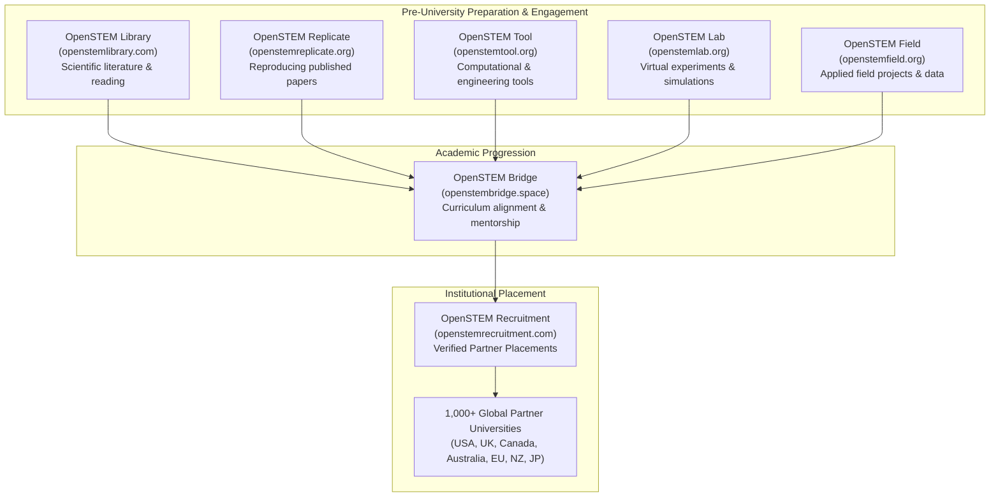

# OpenSTEM Academic Ecosystem: Institutional Value Proposition
**Building Unrivaled Institutional Trust with Global Universities**  
**Entity:** OpenSTEM Digital Education & Research Network  
**Target Audience:** University Deans of Admissions, Directors of International Partnerships, Global Engagement Officers  

---

## 1. The Core Strategic Problem OpenSTEM Solves for Universities

International recruitment offices in the United States, United Kingdom, Canada, Australia, and Europe receive dozens of generic inquiries every week from standard commercial education brokers.

Universities face severe risks with conventional recruitment agencies:
1. **Visa Rejections & Compliance Penalties:** Strict visa scrutiny (UKVI refusal rates, Australian Genuine Student tests, Canadian study permit caps) penalizes universities that work with agents who recruit unqualified candidates.
2. **Academic Underpreparedness:** High dropout rates in foundational STEM, computer science, and engineering courses due to lack of practical lab and research experience in home countries.
3. **Transactional Relationships:** Conventional agents disappear the moment the commission check clears, leaving the university to deal with retention problems.

### How OpenSTEM Completely Changes the Dynamic
OpenSTEM is not just an application processor. **OpenSTEM is a full-stack digital STEM education and research preparation ecosystem.**

Through our network of interconnected web platforms, we engage students months before they ever apply for university. They use our platforms for scientific reading, code replication, virtual laboratory simulations, and computational problem-solving.

When an OpenSTEM student applies to a partner university:
- Their academic aptitude is already demonstrated through platform engagement.
- Their genuine academic intent is verifiable through real project work and portfolio artifacts.
- Their visa success rate is vastly superior because their statement of purpose reflects genuine technical preparation.

---

## 2. The 7 Platforms of the OpenSTEM Network

Here is how each platform within the OpenSTEM network supports the university recruitment mission:

### 1. OpenSTEM Recruitment (`https://openstemrecruitment.com/`)
- **Primary Function:** The central institutional recruitment hub connecting prospective students with partner universities.
- **For Universities:** Provides a structured, auditable candidate pipeline with complete academic dossiers, certified transcripts, verified English test scores (IELTS/TOEFL/PTE/Duolingo), and financial due diligence.
- **For Students:** Free, ethical university selection counseling, admissions document review, visa interview readiness workshops, and pre-departure briefings.

### 2. OpenSTEM Library (`https://openstemlibrary.com/`)
- **Primary Function:** Curated digital library providing open-access scientific literature, textbooks, research papers, and technical monographs for aspiring STEM scholars.
- **Value to Universities:** Ensures candidates from developing regions have read contemporary scientific literature, understand citation standards, and are familiar with Western academic research conventions before starting their degree.

### 3. OpenSTEM Replicate (`https://openstemreplicate.org/`)
- **Primary Function:** A dedicated platform for computational and scientific reproducibility, encouraging students to reproduce experiments, algorithms, and models published in peer-reviewed journals.
- **Value to Universities:** Proves student research integrity and hands-on coding/data analysis capability. Students can showcase replicated models in their admissions portfolios for computer science, data science, and physics faculties.

### 4. OpenSTEM Tool (`https://openstemtool.org/`)
- **Primary Function:** Online suite of computational, mathematical, and algorithmic tools for engineering, chemistry, mathematics, and data processing.
- **Value to Universities:** Bridges the digital divide, allowing students without expensive proprietary software licenses to master essential STEM computation.

### 5. OpenSTEM Lab (`https://openstemlab.org/`)
- **Primary Function:** Interactive virtual laboratory simulations in physics, chemistry, biology, and electronics.
- **Value to Universities:** Overcomes the lack of physical lab equipment in many secondary and regional undergraduate institutions in South Asia. Students arrive on campus with practical experimental intuition.

### 6. OpenSTEM Field (`https://openstemfield.org/`)
- **Primary Function:** Applied field science, environmental data collection, and practical case studies.
- **Value to Universities:** Fosters interdisciplinary problem-solving, community-based environmental science, and practical research experience that stands out in competitive graduate admissions.

### 7. OpenSTEM Bridge (`https://www.openstembridge.space/`)
- **Primary Function:** Formal transitional bridging academy connecting high school and regional university students to international undergraduate and postgraduate degree standards.
- **Value to Universities:** Serves as the direct feeder mechanism. Bridge modules teach academic English writing, critical thinking, research ethics, and university preparation.

---

## 3. The 4 Institutional Promises to Partner Universities

When presenting OpenSTEM to a university partner committee, we lead with our **Four Institutional Safeguards**:

### 1. The "Genuine Student" Guarantee (Zero Visa Fraud)
OpenSTEM conducts rigorous pre-application screening:
- In-person and video identity verification.
- Academic credential validation directly against issuing boards/universities.
- Financial audit: Independent verification of family income, tax certificates, and genuine bank solvency to ensure full compliance with visa financial requirements.

### 2. Academic Readiness & High Retention
Because our applicants use the OpenSTEM ecosystem tools before departure, they do not suffer from the first-semester academic shock common among international students. This directly improves the university's official retention and graduation metrics.

### 3. Transparent, Auditable Operations
- OpenSTEM does **not** charge students undisclosed fees.
- OpenSTEM clearly distinguishes university-issued admissions policies from our preparatory guidance.
- OpenSTEM provides full audit trails for every referred applicant, including original transcripts and verification certificates.

### 4. Direct STEM Diversity Pipeline
Universities worldwide are striving to increase diversity and high-performing enrollments in STEM disciplines (Engineering, AI/Data Science, Biotechnology, Clean Energy, Mathematics). OpenSTEM provides a dedicated, high-caliber talent funnel from South Asia.

---

## 4. Pitch Snippets for Email & Proposal Documents

### Institutional Pitch Blurb (30 seconds)
> *"OpenSTEM (openstemrecruitment.com) is an integrated STEM education and university recruitment network. Alongside our admissions placement services, we operate a suite of open digital learning platforms—including OpenSTEM Lab (virtual science simulations), OpenSTEM Replicate (computational research reproducibility), and OpenSTEM Library. This allows us to prepare, mentor, and pre-qualify high-achieving STEM and multidisciplinary applicants before recommending them to world-class institutions like [University Name]. We would welcome the opportunity to formalize an authorized recruitment partnership with your international office."*

### Value Addition for Engineering & Computer Science Faculties
> *"Unlike traditional generalist agencies, OpenSTEM applicants arrive with documented experience in computational tools (OpenSTEM Tool) and simulated laboratory environments (OpenSTEM Lab). This ensures they hit the ground running in demanding STEM degree programs with minimal attrition."*
