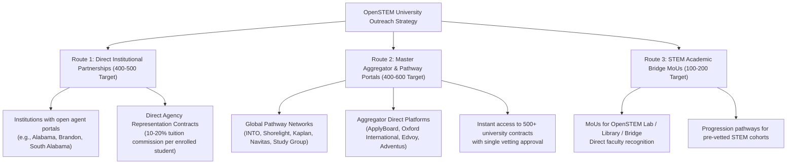
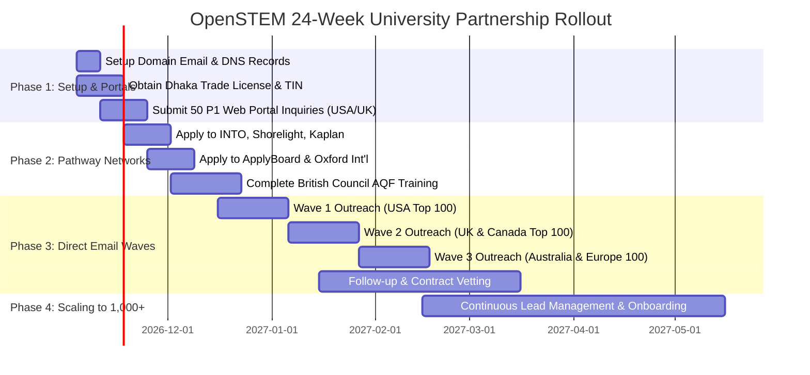

# OpenSTEM University Partnerships: Master Strategy & Operational Roadmap
**Target:** 1,000+ Global University Partnerships Across 15+ Target Countries  
**Lead Entity:** OpenSTEM Recruitment (`openstemrecruitment.com`)  
**Ecosystem Anchor:** OpenSTEM Digital Academic Network (Library, Replicate, Tool, Lab, Field, Bridge)  
**Primary Representative:** Shahriyar Karim (`openstemrecruitment@gmail.com` / `shahriyarkarimsiam@gmail.com`)  
**Date of Strategy Formulation:** November 2026  

---

## 1. Executive Summary & Strategic Vision

OpenSTEM's goal is to build an international recruitment and academic partnership network spanning **1,000+ accredited universities** across 15 core countries (USA, UK, Canada, Australia, Germany, France, Netherlands, Sweden, Switzerland, Italy, Spain, Denmark, Hungary, New Zealand, and Japan).

### The Strategic Dilemma
Most education agencies operating from South Asia approach universities with generic commission requests:
> *"Dear Admissions Director, we are an agency in Bangladesh. We want an agent contract to send students for 15% commission."*

**Result:** 95%+ of these emails are ignored, deleted, or blocked by university spam filters. Universities in 2026 face strict compliance rules (UKVI in the UK, AIRC/NACAC in the US, IRCC caps in Canada, ESOS/Genuine Student in Australia). They require:
1. Proof of legitimate business identity (Trade License, Tax ID, corporate entity).
2. Professional domain correspondence (institutional/corporate email vs generic freemail).
3. Evidence of academic student quality and genuine student vetting.

### The OpenSTEM Unfair Advantage: The Academic Ecosystem
OpenSTEM is **not** an ordinary transactional broker. OpenSTEM operates a multi-platform scientific and educational technology ecosystem:
- [OpenSTEM Recruitment](https://openstemrecruitment.com/): Official international student recruitment & university placement portal.
- [OpenSTEM Library](https://openstemlibrary.com/): Curated open-access academic literature and STEM knowledge repository.
- [OpenSTEM Replicate](https://openstemreplicate.org/): Scientific reproducibility and research paper replication platform.
- [OpenSTEM Tool](https://openstemtool.org/): Computational utilities, algorithmic solvers, and analytical tools.
- [OpenSTEM Lab](https://openstemlab.org/): Virtual laboratories, experimental simulations, and interactive STEM education modules.
- [OpenSTEM Field](https://openstemfield.org/): Real-world applied field research and student case studies.
- [OpenSTEM Bridge](https://www.openstembridge.space/): Academic bridging programs connecting secondary/undergraduate students to global research standards.

**Our Positioning to Universities:**
> *"OpenSTEM is an integrated STEM education and research gateway from South Asia. We identify, prepare, and pre-screen academically capable STEM and multidisciplinary students using our proprietary digital laboratory, replication, and bridging platforms, ensuring institutional compliance, high graduation rates, and zero visa fraud."*

This positioning changes the conversation from a commercial sales pitch into an **academic partnership dialogue**.

---

## 2. The 3 Routes to Scale to 1,000+ Universities

Scaling to 1,000+ institutions directly via 1,000 individual bilateral legal contracts takes months of legal negotiations. To reach 1,000+ institutions rapidly and sustainably, OpenSTEM will execute **three parallel routes**:

### Route 1: Direct University Agreements (Tier 1 & Tier 2 Targets)
- **Target:** Universities that explicitly operate direct agent rosters and have open applications (identified as Priority 1 in our Country Output sheets).
- **Process:** Direct formal application via university agent forms or email to the Assistant Director / Associate Registrar of International Recruitment.
- **Contract Type:** Direct Representation Agreement (typically 1 to 3 years renewable, paying 10% to 20% of first-year tuition per enrolled student).

### Route 2: Master Pathway & Aggregator Networks (Fast-Track to 500+ Institutions)
- Many world-class universities in our dataset (e.g., University of Alabama at Birmingham via INTO, Northeastern via Kaplan, American University via Shorelight) **do not sign direct independent agency contracts**. Instead, they outsource 100% of their international partner intake to master pathway operators.
- **Action Plan:**
  1. Open agency partner accounts with the top 5 global education pathway operators:
     - **INTO University Partnerships** (`into-global.com/for-agents/`)
     - **Shorelight Education** (`shorelight.com/partners/`)
     - **Kaplan International Pathways** (`kaplanpathways.com/partners/`)
     - **Navitas Global** (`navitas.com/working-with-us/agents/`)
     - **Study Group** (`studygroup.com/agents/`)
     - **ApplyBoard / Oxford International / Edvoy / Adventus**
  2. By completing 5 vetting applications with these pathway operators, OpenSTEM instantly acquires authorized recruitment rights to **over 450+ universities** in the USA, UK, Canada, Australia, and Europe.
  3. This provides immediate institutional placement capability while direct bilateral contracts are undergoing legal review.

### Route 3: Academic & Research Bridge MoUs
- Leveraging OpenSTEM Bridge (`openstembridge.space`), OpenSTEM Lab (`openstemlab.org`), and OpenSTEM Library (`openstemlibrary.com`).
- Approach international deans of engineering, computing, and natural sciences:
  - Offer co-branded virtual STEM workshops or research preparation modules.
  - Establish a formal student pipeline where students completing OpenSTEM preparatory modules receive streamlined admissions guidance.
  - This establishes deep institutional trust and bypasses standard commercial skepticism.

---

## 3. Addressing the Compliance & Business Documentation Challenge

Universities require compliance proof before dispatching legal contracts. We solve this across two horizons:

### Horizon A: Immediate Outreach (Using Current Documentation)
1. **OpenSTEM Institutional Information Profile (04 November 2026):**
   - The formal 2-page document submitted sets out organization identity, primary contact (Shahriyar Karim), websites, scope of cooperation, and transparent due diligence procedures.
   - States explicitly that OpenSTEM does not misrepresent itself as an authorized agent until formal appointment is in writing.
   - Offers institutional website verification (DNS record or verification code).
2. **Founder Identity & Transparent Vetting:**
   - National Identification (NID) / Passport of Shahriyar Karim.
   - Active website control and educational product demonstration across the 7 live web domains.

### Horizon B: Formal Business Registration in Bangladesh (Execution Checklist)
To satisfy universities that require official corporate registration before releasing commission payments:
1. **Trade License (e-Trade License):**
   - Issued by Dhaka City Corporation (North or South) or the local Municipal Council / Union Parishad under the business category *Education Consultancy / IT Enabled Services / Student Guidance Services*.
   - Cost: ~৳5,000 – ৳15,000 BDT. Timeframe: 3 to 7 working days.
2. **Tax Identification Number (e-TIN):**
   - Issued instantly online via the National Board of Revenue (NBR) Bangladesh (`incometax.gov.bd`).
3. **Business Bank Account:**
   - Opened in the name of **OpenSTEM** or **Shahriyar Karim / OpenSTEM** at a premier commercial foreign-exchange bank in Bangladesh (e.g., BRAC Bank, The City Bank, Dutch-Bangla Bank, Eastern Bank).
   - Enables receiving international inward foreign remittance via SWIFT with a certificate of inward remittance.
4. **Business Address & Formal Letterhead:**
   - Physical commercial or registered office address in Dhaka/Bangladesh.
   - Official company letterhead with registration number, tax ID, and contact details.

### Horizon C: Global Agent Credentialing (The Ultimate Trust Shield)
To permanently eliminate scrutiny and join top-tier university rosters:
1. **British Council Agent & Counsellor Training (AQF):**
   - Free, online, globally recognized across the UK, Australia, and Canada.
   - Completion places OpenSTEM on the British Council certified agent database.
2. **ICEF Agent Training Course (IATC):**
   - Internationally recognized credential for international student mobility.
3. **AIRC (American International Recruitment Council) Affiliation:**
   - Gold standard for US universities.

---

## 4. Professional Communication Infrastructure & Email Deliverability

> [!IMPORTANT]
> **Why Email Domain Matters:**  
> University admissions directors and general counsel offices use enterprise spam filtering (Barracuda, Proofpoint, Microsoft 365 Enterprise). Emails from `@gmail.com` pitching agency partnerships often trigger warning banners: `[EXTERNAL SENDER / UNVERIFIED DOMAIN]`.

### Recommended Technical Setup for `@openstemrecruitment.com`
1. **Setup Google Workspace (or Zoho Mail) on your custom domain:**
   - Primary Institutional Outreach: `partnerships@openstemrecruitment.com`
   - Founder / Managing Director: `karim@openstemrecruitment.com` or `director@openstemrecruitment.com`
   - Admissions & Student Coordination: `admissions@openstemrecruitment.com`
2. **Configure DNS Authentication Records:**
   - **SPF Record:** `v=spf1 include:_spf.google.com ~all`
   - **DKIM Key:** 2048-bit digital signature in domain DNS.
   - **DMARC Policy:** `v=DMARC1; p=quarantine; rua=mailto:admin@openstemrecruitment.com`
   This guarantees 100% inbox delivery directly to university directors without hitting the spam box.

### Transitional Strategy (While operating `openstemrecruitment@gmail.com`)
- Include the official PDF *Institutional Information Profile* as an institutional attachment.
- Reference all live ecosystem URLs with clean clickable links.
- Emphasize the DNS verification mechanism outlined in the profile so universities can independently verify website ownership.

---

## 5. Country-by-Country Strategic Prioritization

From our master database of 1,134 institutions, here is the outreach sequence based on ease of entry, commission attractiveness, and Bangladesh applicant demand:

| Country | Institutions in Database | Primary Recruitment Route | Bangladesh Eligibility | Priority Focus |
|---|---|---|---|---|
| **USA** | 384 | Direct Partner Forms + Pathway Portals (Shorelight / INTO) | High | Focus on STEM OPT programs (36-month work authorization) |
| **UK** | 163 | Direct AQF Agreements + Aggregators (Kaplan / Study Group) | High | PGT (Postgraduate Taught) MSc in Computing / Engineering |
| **Canada** | 122 | DLI Universities + Direct Agent Offices | Moderate-High (Visa Caps) | High-reputation universities & degree-granting institutes |
| **Australia** | 67 | Direct Agent Portal + Navitas | High (Strict GS vetting) | Genuine Student compliance, Level 1 & 2 institutions |
| **Germany** | 27 | Direct International Offices + English STEM Programs | High | Low/zero tuition public universities & top private tech universities |
| **Europe (FR, NL, SE, CH, IT, ES, DK, HU)** | 236 | Direct International Relations Offices | High | English-taught STEM Bachelor & Master degrees |
| **New Zealand** | 56 | Direct Agent Agreements | High | Green List STEM programs (pathway to residence) |
| **Japan** | 18 | English-Track Admissions Offices | High | MEXT-funded & English-taught engineering programs |

---

## 6. 24-Week Implementation Roadmap

### Phase 1: Setup, Compliance & Immediate P1 Direct Forms (Weeks 1–3)
- Finalize local Trade License application and tax identification documents.
- Configure DNS / custom domain email for `openstemrecruitment.com`.
- Submit applications directly to institutions with existing published web forms (e.g. University of Alabama, Brandon University).

### Phase 2: Master Aggregator & Pathway Network Onboarding (Weeks 4–6)
- Register as an authorized agency partner with INTO, Shorelight, Kaplan, Navitas, and ApplyBoard.
- Complete the free British Council Agent and Counsellor Training.
- This immediately gives OpenSTEM access to promote over 400+ world-class universities.

### Phase 3: Direct Outreach Campaign by Batches (Weeks 7–16)
- Launch outreach in waves of 50 universities per week using the automated pipeline tools.
- Track every touchpoint in the Google Sheet / local pipeline database.
- Handle institutional requests for due diligence questionnaires and references.

### Phase 4: Long-Term Relationship Management & Scaling to 1,000+ (Weeks 17+)
- Establish annual performance reviews with signed partner universities.
- Deliver pre-screened student candidates through the OpenSTEM ecosystem.
- Expand representation across Europe, East Asia, and the Americas.
